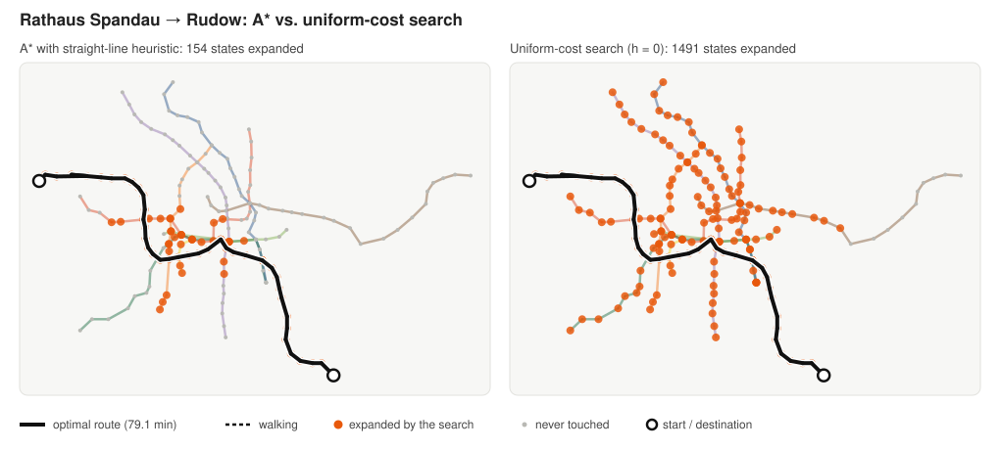

# Berlin Route Planner: A* Search over Walking + U-Bahn

A multimodal route planner for Berlin that finds the **fastest door-to-door route between any two coordinates**, combining walking and the U-Bahn network. It's implemented from scratch in plain Java (no dependencies) around an **A\* search with an admissible geographic heuristic**.



*The same query solved twice. A\* (left) only expands stations along the corridor towards the destination, while uniform-cost search (right) spreads out over the whole network before it reaches Rudow. Both return the same 79.1-minute route. The image is generated by the program itself (`java RoutePlanner --svg docs/astar-vs-ucs.svg`).*

```
SCENARIO: C: Alexanderplatz -> Rathaus Neukölln (one transfer)
Status: optimal solution found
  01. walk_start   START                     -> U8:Alexanderplatz           0.00 min
  02. travel       U8:Alexanderplatz         -> U8:Jannowitzbrücke          1.90 min
  ...
  07. travel       U8:Schönleinstraße        -> U8:Hermannplatz             1.90 min
  08. transfer     U8:Hermannplatz           -> U7:Hermannplatz             5.00 min
  09. travel       U7:Hermannplatz           -> U7:Rathaus Neukölln         2.00 min
  10. walk_end     U7:Rathaus Neukölln       -> GOAL                        0.00 min
Total time: 17.80 min | Path length: 10
Expanded states   : 51
```

## The heuristic and why A\* stays optimal

For a node *n* the heuristic estimates the remaining travel time as

```
h(n) = haversine_distance(n, destination) / v_max
```

where `v_max` is the **fastest speed found anywhere in the network**. It's computed while the data loads, as the maximum of `distance / duration` over all U-Bahn edges (≈ 28 km/h). Walking (5 km/h) is slower than that.

**Admissibility.** No route can cover the remaining distance faster than a straight line at the highest speed available, because every real route is at least as long as the straight line and never faster than `v_max`. So `h(n)` never overestimates the true remaining cost, and A\* returns an optimal route.

**Consistency.** For any edge *n → n'* with cost *c*, the triangle inequality gives `dist(n, goal) ≤ dist(n, n') + dist(n', goal)`, and `dist(n, n') / v_max ≤ c`. Therefore `h(n) ≤ c + h(n')`, so f-values never decrease along a path.

Transfers have no geographic distance (same station, 5 min), so the heuristic simply ignores them. That keeps it admissible, but it's the main reason the estimate is loose on routes with many transfers.

### Does the heuristic pay off?

`java RoutePlanner --compare` runs every route twice: once with A\*, once with `h = 0` (uniform-cost search / Dijkstra). Both always find the same optimal travel time, but A\* expands far fewer states:

| Route | Optimal time | Expanded (A\*) | Expanded (UCS) | Saved |
|---|---:|---:|---:|---:|
| Alexanderplatz → Prenzlauer Berg (walk only) | 10.1 min | 29 | 56 | 48 % |
| Möckernbrücke → Friedrichshain | 18.8 min | 75 | 321 | 77 % |
| Alexanderplatz → Rathaus Neukölln | 17.8 min | 51 | 160 | 68 % |
| Siemensdamm → Hermannplatz | 37.6 min | 46 | 195 | 76 % |
| Rathaus Spandau → Rudow | 79.1 min | 154 | 1491 | 90 % |
| Hönow → Rathaus Spandau | 104.2 min | 451 | 1648 | 73 % |

The longer the route, the bigger the gain: on cross-city trips the straight-line estimate prunes most of the network that points away from the destination.

## Problem formulation

| | |
|---|---|
| **States** | `START`, one node per *line × station* (e.g. `U2:Alexanderplatz`), and `GOAL` |
| **Actions** | `walk_direct` (start → goal), `walk_start` (start → nearby station), `travel` (next station on the same line), `transfer` (change line at the same station, 5 min), `walk_end` (station → goal) |
| **Cost** | travel time in minutes; walking at 5 km/h over haversine distance |
| **Goal test** | applied when a node is *expanded*, not when it's generated. This is what makes the first solution popped from the queue optimal |

Modelling each line at a station as its own state is what makes transfer costs possible: changing from `U8:Hermannplatz` to `U7:Hermannplatz` is an explicit edge with a 5-minute cost.

## Design decisions

- **Walking limits.** Walking to or from a station is allowed up to 15 min, and a direct walk without the U-Bahn up to 30 min. Without these limits the search would consider walking from Spandau to Neukölln. If no station is within range (outer districts), the 2 nearest stations are used instead.
- **Cycle check.** A successor is discarded if its state is already on the current path.
- **Duplicate pruning.** The planner keeps the best `g` per `(state, depth)` and skips worse or stale copies when they're popped from the priority queue.
- **Depth limit `p_max`** (default 50, the longest optimal route in the network has 47 actions). Successors deeper than `p_max` aren't added to the queue, similar to depth-limited search. If that happened during a search that still found a solution, the result is reported as *potentially non-optimal*, because a pruned path could have been better.
- **Time limit** (default 10 s). When the limit is hit, the planner returns the best goal node generated so far, or reports failure.
- **Tie-breaking.** Nodes with equal `f` are ordered by lower `g`.

## Edge cases

Running without arguments executes six scenarios that show both normal behaviour and how the limits affect the result:

| | Scenario | Behaviour |
|---|---|---|
| A | Alexanderplatz → Prenzlauer Berg | Walking is fastest. A\* still opens a few U-Bahn paths before confirming it |
| B | Möckernbrücke → Friedrichshain | One line (U1), no transfer |
| C | Alexanderplatz → Rathaus Neukölln | One transfer (U8 → U7 at Hermannplatz) |
| D | Rathaus Spandau → Rudow, `p_max = 40` | The 40-step U7 ride is returned, but deeper paths were cut, so it's flagged *potentially non-optimal*. With the default `p_max`, the true optimum is 79.1 min, compared with 84.7 min here |
| E | Hönow → Rathaus Spandau, `p_max = 40` | No route fits within 40 steps: *no solution with limited memory* |
| F | Siemensdamm → Hermannplatz, 0.0001 s | Time limit hit before any solution is found |

## Usage

Requires Java 8+. The CSV must be in the working directory.

```bash
javac -encoding UTF-8 RoutePlanner.java

java RoutePlanner                     # run demo scenarios A–F
java RoutePlanner --compare           # A* vs. uniform-cost search table
java RoutePlanner --svg map.svg       # draw expanded states of A* and UCS (Spandau -> Rudow)
java RoutePlanner --svg map.svg 52.5213 13.4114 52.4816 13.4341  # same for a custom route
java RoutePlanner 52.521389 13.411944 52.481667 13.434167        # custom route
java RoutePlanner 52.5350 13.2003 52.4158 13.4961 40 5           # with p_max = 40, timeout 5 s
java RoutePlanner -v 52.521389 13.411944 52.481667 13.434167     # print every expanded path with f, g, depth
```

| Argument | Meaning |
|---|---|
| `startLat startLon destLat destLon` | coordinates in decimal degrees (`.` or `,` as decimal separator) |
| `p_max` | optional, maximum path length (default 50) |
| `timeoutSec` | optional, search time limit in seconds (default 10) |
| `-v` | trace every expanded node |
| `--compare` | run the A\* vs. UCS comparison |
| `--svg file` | write an SVG map comparing the states expanded by A\* and UCS |

The program logs start/destination, the route, **expanded states** and **maximum OPEN list size** (memory usage) for every query.

## Data

`berlin_ubahn_network.csv` describes the U-Bahn as a directed graph. Each row is either a `travel` edge between neighbouring stations of one line, with its ride time, or a `transfer` edge between two lines at the same station (5 min). Every row has the coordinates of both endpoints.
